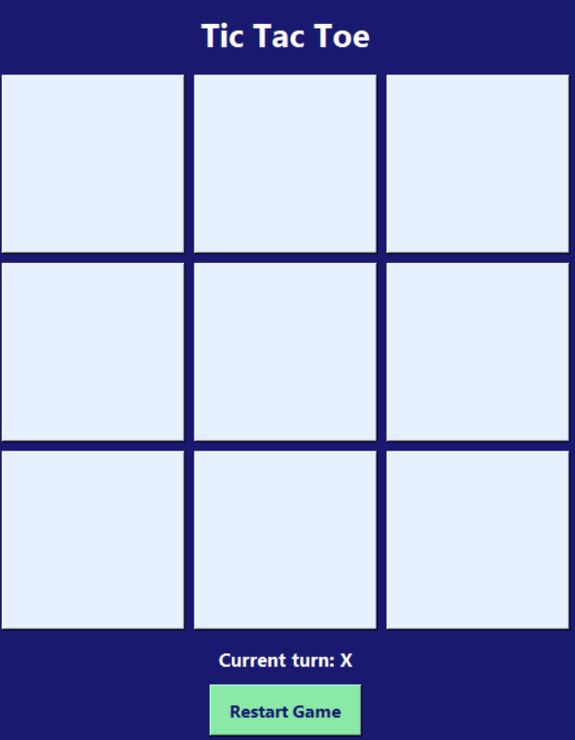
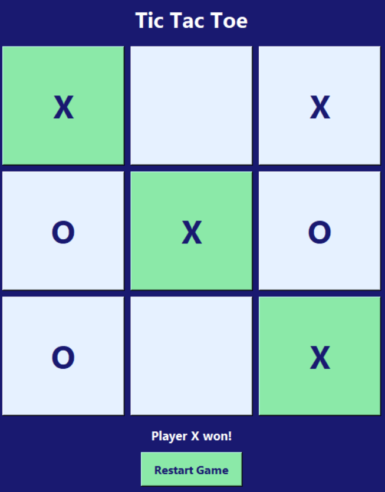
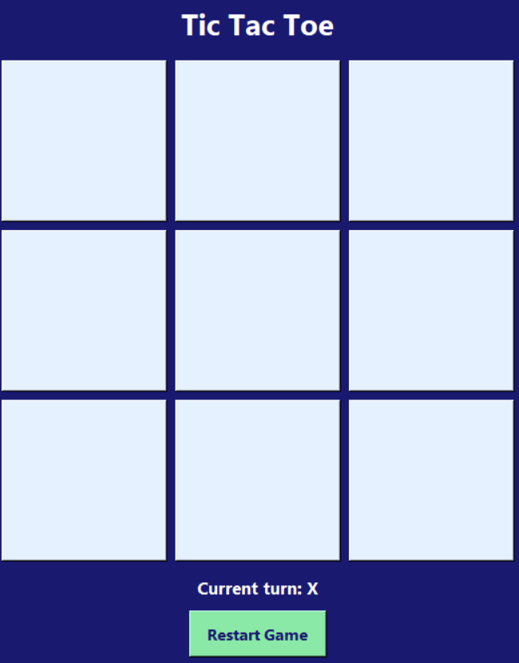
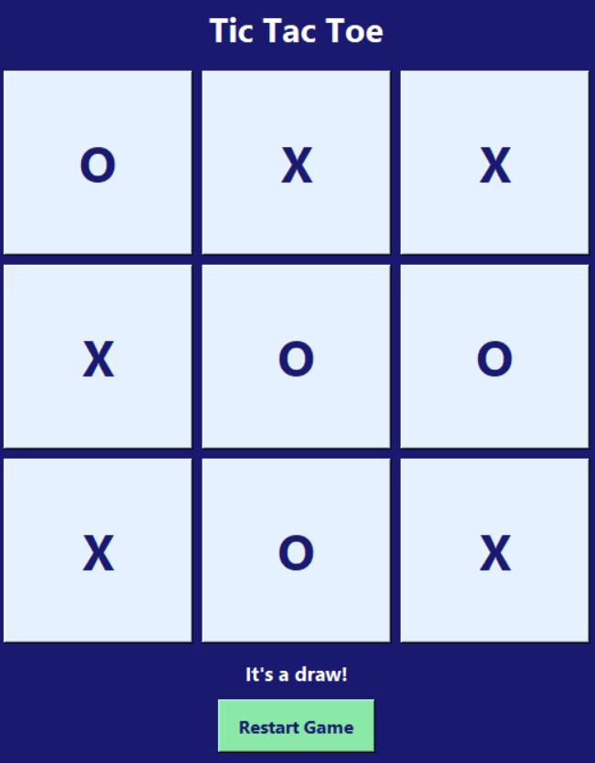

# 🎮 Tic-Tac-Toe

### A classic game built with Python and Tkinter

A beginner-friendly desktop game where two players take turns placing **X** and **O** on a 3 × 3 board. The game detects wins and draws, highlights winning cells, and lets you restart for another round.


---

## 📸 Screenshots

### 1. Game Board



[View Game Board Screenshot](./screenshots/game-board.png)

### 2. Winning Move



[View Winning Move Screenshot](./screenshots/win-highlight.png)

### 3. Restarted Game



[View Restarted Game Screenshot](./screenshots/restarted-game.png)

### 4. Draw Result



[View Draw Result Screenshot](./screenshots/draw-result.png)

---

## ✨ Features

- 🧩 **Interactive 3 × 3 board** — play locally with two players.
- 🔄 **Alternating turns** — X and O take turns automatically.
- 🏆 **Win detection** — checks rows, columns, and both diagonals.
- 🟩 **Winning-cell highlight** — highlights the three cells in a winning line.
- 🤝 **Draw detection** — recognizes when the board is full without a winner.
- 🔁 **Restart button** — clears the board and starts a new round.
- 🎨 **Custom interface** — midnight-blue background, light-blue cells, and clear status text.

## 🛠️ Built With

- **Python** — game logic and event handling.
- **Tkinter** — graphical user interface.

## 🚀 Getting Started

### Prerequisites

Install Python from [python.org](https://www.python.org/downloads/) if it isn't already installed.

Check your Python installation:

```bash
python --version
```

On some systems, use:

```bash
python3 --version
```

### 1. Clone the repository

```bash
git clone https://github.com/dhruvbansal-532/Tic-Tac-Toe.git
```

Navigate into the repository:

```bash
cd Tic-Tac-Toe
```

### 2. Run the game

```bash
python script.py
```

If your Python file has a different name, replace `tic_tac_toe.py` with its actual filename.

On some systems, use:

```bash
python3 script.py
```

A desktop window should open. No internet connection is needed to play once Python and the project files are available locally.

## 🎯 How to Play

1. Run the Python file.
2. Player **X** starts the game.
3. Players take turns selecting an empty cell.
4. Get three matching symbols in a row, column, or diagonal to win.
5. If all nine cells are filled and nobody wins, the game ends in a draw.
6. Click **Restart Game** to start another round.

## 📂 Project Structure

```text
Tic-Tac-Toe/
├── script.py
├── README.md
├── .gitignore
└── screenshots/
    ├── game-board.png
    ├── win-highlight.png
    ├── restarted-game.png
    └── draw-result.png
```

If your Python file has a different name, keep your existing filename and update the run command accordingly.

## 🧠 What I Practised

This project helped me practise:

- Python functions, conditions, loops, and lists.
- Working with Tkinter widgets and the `grid()` layout manager.
- Handling button clicks and callbacks.
- Passing arguments to functions.
- Detecting winning combinations and draws.
- Updating widget text and colours dynamically.
- Resetting the game state.

## 🔮 Possible Future Improvements

- Keep a score for X wins, O wins, and draws.
- Add hover effects to the board cells.
- Add a single-player mode against a computer opponent.
- Add sound effects and more visual themes.

## 👤 Author

**Dhruv Bansal**

- GitHub: [@dhruvbansal-532](https://github.com/dhruvbansal-532)

---

_Built with Python, curiosity, and a lot of debugging. 💙_

If you find this project interesting, consider giving the repository a ⭐.
